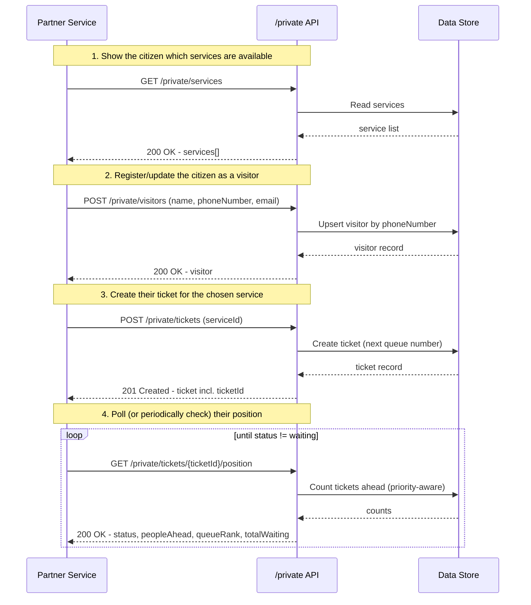
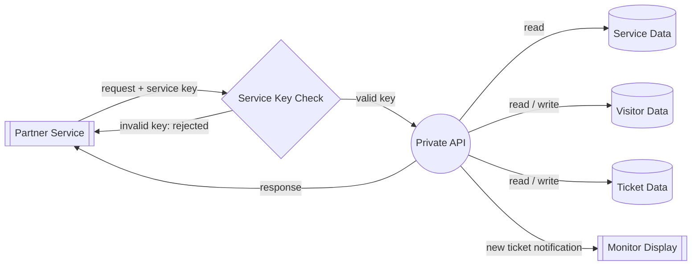

# Private API Documentation (Service-to-Service)

This document describes the private API — the integration point for **other backend services** to plug into the queueing system (list services, register a visitor, create a ticket on their behalf, and track that ticket's position in line). It is self-contained and meant to be shared with partner/integrating teams; it does not assume access to the rest of this repository.

Base URL: `{host}/api/v1/private`

---

## 1. Authentication

Every request must include:

```
X-Service-Key: <your-service-key>
```

- Keys are issued per calling service (not shared) — request one from the platform team.
- There is no user login, session, or JWT involved here. This is a completely separate trust boundary from the staff/admin UI's `Authorization: Bearer <jwt>` auth.
- Missing or invalid key → `401 Unauthorized`:
  ```json
  {
    "success": false,
    "error": { "code": "UNAUTHORIZED", "message": "Invalid service key" }
  }
  ```

```bash
curl {host}/api/v1/private/ping \
  -H "X-Service-Key: <your-service-key>"
```

---

## 2. Typical Integration Flow

The intended end-to-end flow for a partner service handling "citizen wants to join a queue, then check their spot":



Two supporting endpoints exist outside that linear flow:

- `GET /private/queues/{serviceId}/summary` — total waiting count for a service _before_ a citizen has a ticket (e.g. showing "Service A: 12 waiting" on a service picker screen).
- `GET /private/queues` — the org-wide "currently being called" board (what's shown on a physical monitor screen right now), independent of any single ticket.

---

## 3. Data Flow Diagram

A high-level view of how data moves through this API — not an implementation diagram.



**Reading the diagram:** rectangles are external parties, the circle is this API, cylinders are the data categories it reads/writes, and every request passes through the service key check before touching any data. Creating a ticket additionally triggers a notification to the live monitor display.

---

## 4. Endpoint Reference

### `GET /private/ping`

**What it's for:** a no-op connectivity/credential check — call this first when wiring up integration to confirm your key works, before building against the real endpoints.

- **Response `200`:**
  ```json
  { "success": true, "message": "pong", "data": { "service": "exampleService" } }
  ```
  `data.service` is your service's name as registered in `SERVICE_API_KEYS` — useful to confirm which identity your key resolves to.
- **`401`:** missing/invalid key.

---

### `GET /private/services`

**What it's for:** step 1 of the flow — list every active service (e.g. "Customer Service", "Document Processing") a citizen could join a queue for, grouped with their organization.

- **Response `200`:**
  ```json
  {
    "success": true,
    "data": {
      "totalRecord": 1,
      "data": [
        {
          "id": "uuid",
          "name": "Customer Service",
          "prefix": "A",
          "organization": {
            "id": "uuid",
            "name": "DPUPR",
            "fullName": "Dinas Pekerjaan Umum dan Penataan Ruang"
          }
        }
      ]
    }
  }
  ```

---

### `POST /private/visitors`

**What it's for:** step 2 — register a citizen, or update their info if they already exist. Matching is by `phoneNumber` (upsert), so calling this repeatedly for the same person is safe and idempotent.

- **Request body:**
  | Field | Type | Required | Notes |
  |---|---|---|---|
  | `name` | string | Yes | |
  | `phoneNumber` | string | Yes | Normalized server-side (e.g. `08123456789` → `628123456789`) |
  | `email` | string | No | |
- **Response `200`:**
  ```json
  {
    "success": true,
    "message": "Success",
    "data": {
      "id": "uuid",
      "name": "John Doe",
      "phoneNumber": "628123456789",
      "email": null,
      "createdAt": "2026-09-10T01:23:03.652Z",
      "updatedAt": "2026-09-10T01:23:03.652Z"
    }
  }
  ```
- **`400`:** validation error (e.g. missing `phoneNumber`).

---

### `POST /private/tickets`

**What it's for:** step 3 — issue a new queue ticket for a service. This is the call that actually puts the citizen in line; the returned `id` is the `ticketId` used by the position-lookup endpoint below. Also triggers a real-time notification to the service's monitor display.

- **Request body:**
  ```json
  { "serviceId": "123123-1234-1234-1234-123456789012" }
  ```
- **Response `201`:**
  ```json
  {
    "success": true,
    "message": "Created",
    "data": {
      "id": "uuid",
      "queueNumber": "A-005",
      "serviceId": "uuid",
      "serviceName": "Customer Service",
      "organizationId": "uuid",
      "organizationName": "DPUPR",
      "organizationFullName": "Dinas Pekerjaan Umum dan Penataan Ruang",
      "createdAt": "2026-09-10T01:25:01.140Z",
      "totalWaitingQueue": 0
    }
  }
  ```
  Note: `totalWaitingQueue` here is a snapshot taken _at creation time_ (how many were waiting when this ticket joined) — for a live, current count use `GET /private/tickets/{ticketId}/position` (`totalWaiting`) after creation.
- **`404`:** `serviceId` does not exist.

---

### `GET /private/tickets/{ticketId}/position`

**What it's for:** step 4 — the core "how many people are in front of me" check. Poll this periodically (e.g. every 15–30s) to update the citizen's view of their place in line.

**How position is computed:** it mirrors the actual serving order used by the system, which always serves every waiting _priority_ ticket (oldest-first) before serving a non-priority one. So:

- If your ticket is priority: only earlier priority tickets count as ahead of you.
- If your ticket is non-priority: **all** waiting priority tickets count as ahead of you, plus any non-priority tickets created before yours.

| Field          | Meaning                                                                                                             |
| -------------- | ------------------------------------------------------------------------------------------------------------------- |
| `status`       | `waiting` (not yet called), `calling` (being served right now), or `resolved` (done)                                |
| `peopleAhead`  | Count of tickets served before this one. **0-indexed**: `0` = you're next. `null` unless `status` is `waiting`.     |
| `queueRank`    | 1-indexed version of the same thing (`peopleAhead + 1`) — "you're #4 in line." `null` unless `status` is `waiting`. |
| `totalWaiting` | Everyone waiting for this service today, including this ticket. Always populated regardless of `status`.            |

- **Response `200` (waiting):**
  ```json
  {
    "success": true,
    "data": {
      "ticketId": "uuid",
      "serviceId": "uuid",
      "queueNumber": "A-005",
      "status": "waiting",
      "peopleAhead": 3,
      "queueRank": 4,
      "totalWaiting": 12
    }
  }
  ```
- **Response `200` (calling / resolved):** same shape, `peopleAhead`/`queueRank` are `null`.
- **`404`:** `ticketId` does not exist.

---

### `GET /private/queues/{serviceId}/summary`

**What it's for:** show queue length for a service _before_ a citizen has committed to a ticket — e.g. a service-picker screen showing "12 waiting" per service. Not part of the linear flow above; call this ahead of ticket creation if you want that preview.

- **Query params:** `status` (optional) — `in-progress` or `completed`; omitted = currently waiting.
- **Response `200`:**
  ```json
  { "success": true, "data": { "totalRecords": 12 } }
  ```
- **`404`:** `serviceId` does not exist.

---

### `GET /private/queues`

**What it's for:** the org-wide "who's being called right now" board — the same data shown on a physical monitor screen. Not scoped to a single service or ticket; returns the most recent tickets currently in `calling` state across all services (capped to the latest 4).

- **Response `200`:**
  ```json
  {
    "success": true,
    "data": [
      {
        "id": "uuid",
        "ticketNumber": "A001",
        "counterNumber": "C01",
        "serviceName": "Customer Service",
        "organizationName": "DPUPR"
      }
    ]
  }
  ```

---

## 5. Error Shape

All errors follow the same envelope, `success: false`:

```json
{
  "success": false,
  "error": { "code": "UNAUTHORIZED", "message": "Invalid service key" },
  "transactionId": "..."
}
```

| Code                    | Status | Meaning                                         |
| ----------------------- | ------ | ----------------------------------------------- |
| `UNAUTHORIZED`          | 401    | Missing/invalid `X-Service-Key`                 |
| `BAD_REQUEST`           | 400    | Request body/params failed validation           |
| `NOT_FOUND`             | 404    | Referenced `serviceId`/`ticketId` doesn't exist |
| `INTERNAL_SERVER_ERROR` | 500    | Unexpected server error                         |

`transactionId` is safe to include when reporting an issue — it correlates to this app's server-side logs.
