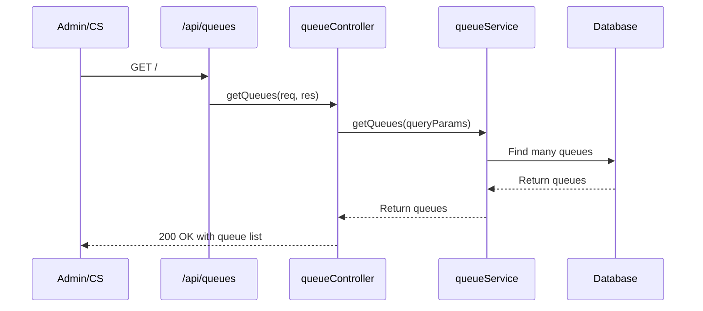
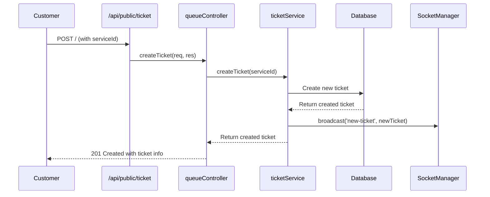
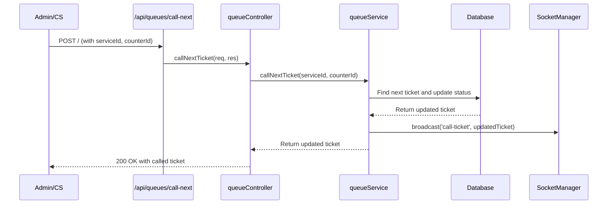
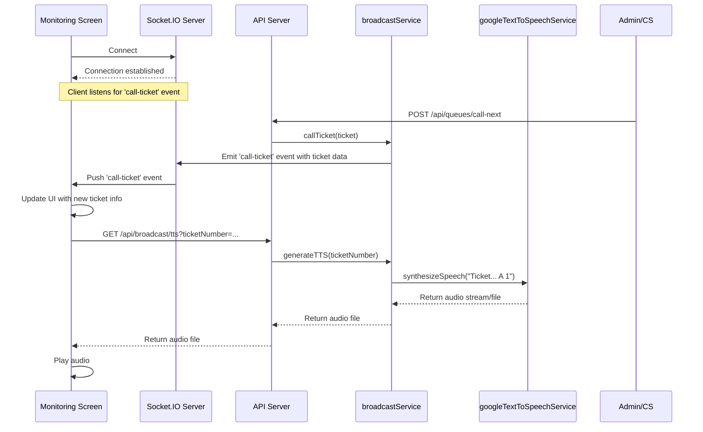

# UML Sequence Diagrams

## 1. Get Queue List (Admin/Customer Service)

## 2. Create Queue (Customer)

## 3. Call Queue (Admin/Customer Service)

## 4. Monitoring Called Queue and Sound Generation

This diagram illustrates the real-time update on the monitoring screen and the subsequent sound generation.

